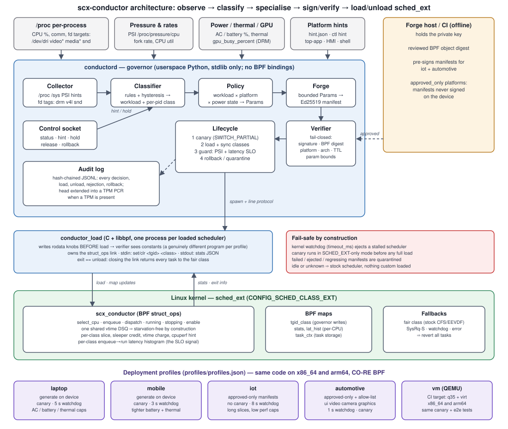

# scx-conductor

Workload-adaptive CPU scheduling for Linux, using [sched_ext](https://docs.kernel.org/scheduler/sched-ext.html).
A small governor watches what the machine is doing (game, UI, browser, video, camera,
graphics, agentic/CPU-heavy work, batch), **specialises a reviewed BPF scheduler template for that
workload**, verifies it, canaries it, hot-loads it, watches for regressions, and unloads it again when the
workload goes away. The same code targets **x86_64 and arm64** and is meant to be tested under **QEMU**.

The idea is borrowed from OpenAI and Cisco's [Shirudo](https://openai.com/index/introducing-shirudo/)
(announced 2026-11-23): Shirudo loads small, signed, tested eBPF "shields" into a running Linux system to block
exploits while a patch is prepared. Here the live-loaded eBPF object is a *scheduler* and the trigger is a
*workload*, not a vulnerability. See [`docs/diagrams/shirudo-mapping.svg`](docs/diagrams/shirudo-mapping.svg).



## Read this first: what has and has not been verified

This repository was written in a sandbox that has **no clang, no libbpf, no QEMU and no sched_ext kernel**.

| Part | Status |
|---|---|
| Governor logic (classifier, policy, forge, verifier, lifecycle, audit, control socket) | **Run:** 62 unit tests pass (Python 3.12, x86_64); daemon dry-run with `FakeHost` ran clean and its audit chain verifies |
| Ed25519 signing / verification via `openssl` CLI | **Run** (part of the tests) |
| Diagrams | **Rendered and visually checked** |
| Shell scripts, in-guest test scripts | **Syntax-checked only** (`bash -n`, `ast.parse`) |
| `loader/conductor_load.c` | **Syntax-checked against stub headers only**, not real libbpf / scx headers |
| `bpf/scx_conductor.bpf.c` | **Never compiled.** Written against the kernel.org sched_ext docs; expect first-build fixes |
| QEMU x86_64 / arm64 boot and in-guest tests | **Not run.** Scripts exist; `docs/REPRODUCE.md` is the procedure |
| Any performance or power result | **None exist.** Profile values are untuned priors (`profiles/profiles.json`) |

Treat the first QEMU run as the real test. [`docs/TESTING.md`](docs/TESTING.md) lists every stage, what it asserts,
and what a failure there most likely means.

## What "on the fly" means here

The governor does **not** write new BPF C at runtime. It writes the `const volatile` knobs of one reviewed
template (`bpf/scx_conductor.bpf.c`) into `.rodata` before load, so the kernel verifier sees constants and each
profile is a genuinely different loaded program, generated in milliseconds without a compiler on the device.
Source-level generation by an agent is a separate, gated, off-device path described in
[`docs/SAFETY.md`](docs/SAFETY.md) (compile in CI, review, sign the new object digest, ship as an approved manifest).

## Layout

```
bpf/            scx_conductor.bpf.c (sched_ext template), conductor.h (shared enums)
loader/         conductor_load.c: loads one specialised instance, line protocol on stdin/stdout
conductord/     governor (Python, stdlib only): signals, classifier, policy, forge, lifecycle, audit, daemon
profiles/       profiles.json: workload x platform x power-state priors (UNTUNED)
tests/          unit tests (run anywhere), tests/guest/ = in-kernel tests (run inside QEMU)
tools/qemu/     build-kernel.sh, make-rootfs.sh, run-qemu.sh, guest-init.sh, kernel.config
tools/workloads latency probe, synthetic apps for classifier tests
docs/           ARCHITECTURE, REPRODUCE, SAFETY, PLATFORMS, TESTING + diagrams (SVG + generator)
memory/         project memory files for future sessions (context, decisions, tuning log, test log)
packaging/      systemd unit
```

## Quick start

Anywhere (no kernel needed): run the logic tests and a dry-run daemon.

```bash
python3 -m unittest discover -s tests            # 62 tests
python3 -m conductord run --platform vm --dev-self-sign --dry-run \
    --state /tmp/cstate --sock /tmp/cstate/ctl.sock --bpf-obj <any-file> --duration 10
python3 -m conductord ctl hold gaming --sock /tmp/cstate/ctl.sock
```

Real kernel, x86_64 and arm64 under QEMU: follow [`docs/REPRODUCE.md`](docs/REPRODUCE.md).

## Licensing note

The BPF program and loader are `GPL-2.0` (required to use sched_ext kfuncs). **No licence has been chosen for the
rest of the repository**; add one before publishing.
