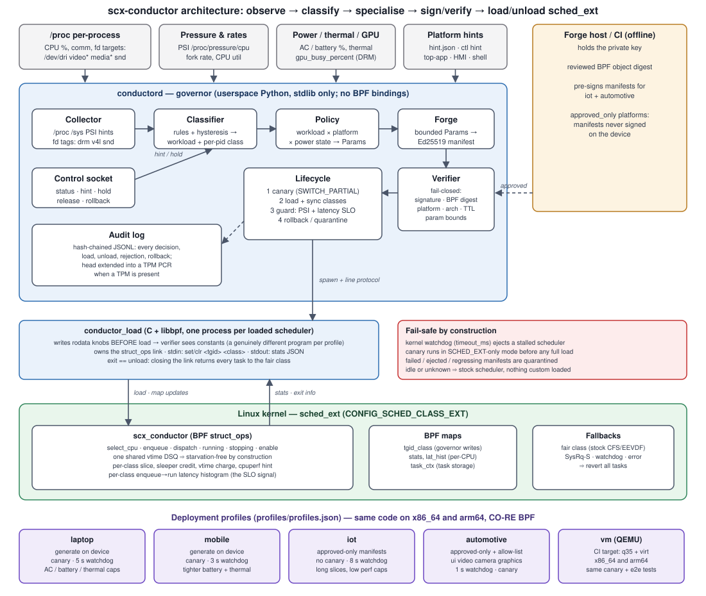
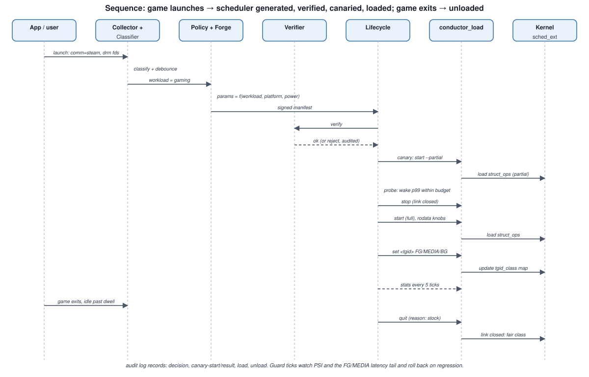

# Architecture

## 1. Data flow

1. **Collector** (`conductord/signals.py`) reads `/proc` (per-process CPU, comm, fd targets), `/proc/pressure/cpu`
   (PSI), fork rate, power-supply and thermal sysfs, GPU busy percent, and an optional hint file. Roots are
   injectable, so tests use a fake procfs.
2. **Classifier** (`classifier.py`) is rule-based and explainable: process names, fd tags (`/dev/dri`, `/dev/video*`,
   `/dev/media*`, `/dev/snd`, `/dev/dma_heap`), GPU load, fork rate, PSI. It returns a workload, a score, the evidence,
   and a per-process class map (`FG`, `MEDIA`, `BG`; everything else is `NORMAL`). A **hint** (from a platform
   service or `conductord ctl hint`) overrides inference.
3. **Debouncer** adds hysteresis: a candidate must win N ticks and the current workload must have held a minimum
   dwell, except a strong (score >= 0.9) launch out of idle/UI, which switches immediately.
4. **Policy** (`policy.py`) maps `(workload, platform, power state)` to bounded `Params`: slice, sleeper credit,
   vtime charge and cpuperf hint per class, plus the watchdog timeout. Power states: `ac`, `battery`,
   `low_battery` (<= 20 %), `thermal` (over the platform limit). `idle` means "no custom scheduler".
5. **Forge** (`forge.py`) wraps the params in a manifest (template digest, platform, arch, kernel_min, TTL) and signs it
   with Ed25519 via the `openssl` CLI. Manifests are cached per key for half their TTL; see `memory/decisions.md`
   for why that matters.
6. **Verifier** is fail-closed: signature, BPF object digest, platform, arch, expiry, clock skew, parameter bounds.
7. **Lifecycle** (`lifecycle.py`) runs canary -> load -> sysfs check -> class sync -> guard, with rollback and
   quarantine. See the state machine below.
8. **conductor_load** (`loader/conductor_load.c`) owns one loaded scheduler. It sets `.rodata` knobs, loads, attaches the
   struct_ops link and serves a line protocol: `set <tgid> <cls>`, `clr <tgid>`, `clrall`, `stats`, `quit`.
   Exiting is unloading.
9. **AuditLog** (`audit.py`): append-only, hash-chained JSONL; the head hash is extended into a TPM PCR when
   `/dev/tpmrm0` and `tpm2_pcrextend` exist.

## 2. The BPF scheduler (`bpf/scx_conductor.bpf.c`)

Deliberately conservative, derived from the shape of `scx_simple`:

- **One shared vtime-ordered DSQ.** Every runnable task sits in one queue ordered by virtual time, so no class can
  be starved, whatever the knobs say.
- **Class-scaled vtime charge** (`charge_pct`): FG/MEDIA are charged less per ns run and so get more CPU share; BG is
  charged more.
- **Class-scaled sleeper credit** (`credit_ns`): how far behind `vtime_now` a long sleeper may start, i.e. the
  wake-up latency boost.
- **Class-scaled slice** (`slice_ns`): short where latency matters, long where throughput or power matters.
- **cpuperf hint** (`perf_target`): `scx_bpf_cpuperf_set()` per class; `0` means leave frequency alone.
- **Latency histogram** per class (enqueue to run, log2 microsecond buckets): the SLO signal the governor reads.
- **`inject_stall`** exists only so the QEMU suite can prove the kernel watchdog ejects a stalling scheduler.

Idle CPUs are used directly in `select_cpu` via `scx_bpf_select_cpu_dfl`, as in `scx_simple`.

## 3. Lifecycle

- **Canary** loads the scheduler with `SCX_OPS_SWITCH_PARTIAL`: only tasks that opt into `SCHED_EXT` use it, everything
  else stays on the fair class. A probe process (`tools/workloads/lat_probe.py --ext`) with CPU hogs measures p99
  wake-up latency; above `canary_p99_us` the manifest is quarantined and never fully loaded.
- **Guard** (every tick): loader liveness, PSI regression (`psi_some10` over baseline + 25 or the 40 floor for 10
  ticks), and every 5th tick the FG/MEDIA latency tail (>= 5 % of samples in bucket >= 13, i.e. around >= 8 ms,
  three checks in a row). Any breach unloads and quarantines for 300 s.
- **Kernel watchdog**: `timeout_ms` is passed to sched_ext. A stalled runnable task makes the kernel abort the BPF
  scheduler and revert tasks to the fair class on its own; the loader sees it (UEI exit), exits 3, and the lifecycle
  quarantines the manifest.
- **Switching** always unloads the old scheduler before verifying and loading the next one.

## 4. Why these choices

See `memory/decisions.md`. In one line each: one DSQ for starvation-freedom; rodata specialisation instead of runtime
codegen so the device needs no compiler and the reviewed object digest never changes; Python governor because
policy changes often and the hot path (scheduling) is in the kernel; a separate loader process so a governor crash
closes the link and falls back to the stock scheduler.

## 5. What is not implemented

- Topology awareness (big.LITTLE / hybrid x86 / NUMA placement). `perf_target` is the only power lever.
- Per-thread classification: classes are per process (tgid).
- An LLM-driven generator. The classifier and policy are deterministic; the manifest path is shaped so a generator
  can sit in front of it (`docs/SAFETY.md`).
- Platform hint producers (Android top-app, automotive HMI, desktop shell): the interface is `hint.json` /
  `conductord ctl hint`; no producer ships here.
